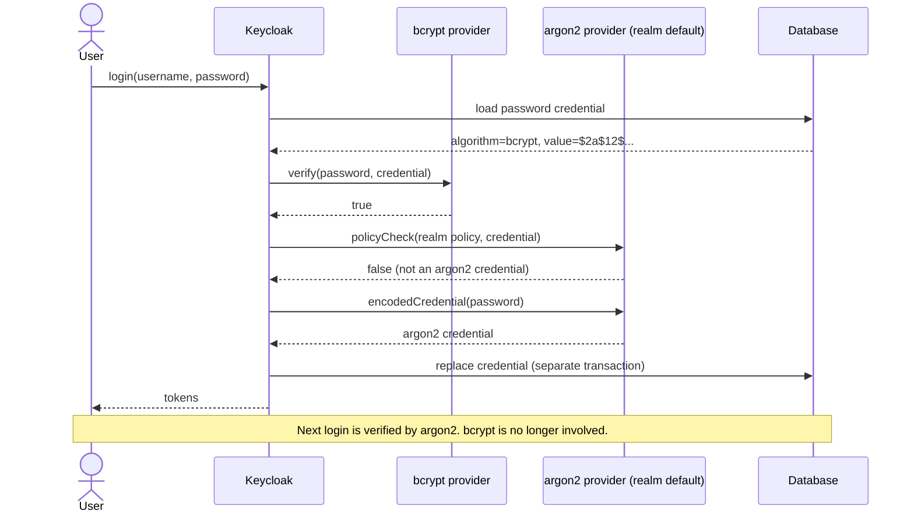

# keycloak-bcrypt

Keycloak password hash provider for bcrypt: import users with their existing `$2a$` / `$2b$` / `$2y$` hashes and let them log in without a password reset.

[](https://openjdk.org/projects/jdk/21/)
[](https://www.keycloak.org/)
[](LICENSE)
[](https://github.com/filipopov/keycloak-bcrypt/actions/workflows/ci.yml)

## Why

Keycloak ships with PBKDF2 and Argon2, but not bcrypt. Spring Security's `BCryptPasswordEncoder`, PHP's `password_hash()`, Laravel, Rails and many other stacks store bcrypt hashes by default. When you move such an application to Keycloak you have two bad options: force every user through a password reset, or keep the old login around.

This provider adds a third: import the existing hashes as they are. Keycloak verifies them with bcrypt on the next login and then re-hashes the password with the realm's own algorithm (Argon2 by default), so bcrypt disappears from your database user by user.

I built it to move Appointiko, a Spring Boot app, from BCrypt hashes in its own database to Keycloak.

## Install

Build the jar with `./mvnw verify` (output: `target/keycloak-bcrypt-0.1.0.jar`). It is a single jar; the bcrypt library is shaded inside.

```bash
cp keycloak-bcrypt-0.1.0.jar /opt/keycloak/providers/
/opt/keycloak/bin/kc.sh build
```

The provider registers under the id `bcrypt`. It does **not** become the server's default hashing algorithm.

### Custom Keycloak image

```dockerfile
FROM quay.io/keycloak/keycloak:26.8.1 AS builder
COPY keycloak-bcrypt-0.1.0.jar /opt/keycloak/providers/
RUN /opt/keycloak/bin/kc.sh build

FROM quay.io/keycloak/keycloak:26.8.1
COPY --from=builder /opt/keycloak/ /opt/keycloak/
ENTRYPOINT ["/opt/keycloak/bin/kc.sh"]
```

## Import users

A password credential in Keycloak has two parts, `credentialData` and `secretData`. Both are **JSON-encoded strings**, not nested objects:

```json
{
  "username": "jane",
  "email": "jane@example.com",
  "emailVerified": true,
  "firstName": "Jane",
  "lastName": "Doe",
  "enabled": true,
  "credentials": [
    {
      "type": "password",
      "credentialData": "{\"hashIterations\":-1,\"algorithm\":\"bcrypt\"}",
      "secretData": "{\"value\":\"$2a$12$KZRBntqSyoQjf2ots3e/ku9H.9/XVg5AjY7nmQMGAGBdxEmDD.cZq\",\"salt\":\"\"}"
    }
  ]
}
```

- `algorithm` must be `bcrypt`. This tells Keycloak which provider verifies the hash.
- `value` is the hash exactly as your old system stored it.
- `hashIterations` and `salt` are ignored. bcrypt keeps the cost and salt inside the hash.

Two ways to load it:

- **Admin REST API**: `POST /admin/realms/{realm}/users` with the body above. [`examples/import-user.sh`](examples/import-user.sh) does this with `curl` and [`examples/create-user.json`](examples/create-user.json).
- **Realm import**: put users in the realm JSON and start Keycloak with `--import-realm`, or use `kc.sh import`. See [`examples/realm-import.json`](examples/realm-import.json), which has one user with a Spring Security `$2a$` hash and one with a PHP/Apache `$2y$` hash.

A unit test ([`ExampleImportFilesTest`](src/test/java/io/github/filipopov/keycloak/bcrypt/ExampleImportFilesTest.java)) runs the example files through Keycloak's own JSON mapping and `RepresentationToModel` code and checks that the documented passwords verify.

## Transparent re-hashing

You don't need to configure anything for this. After every successful login Keycloak asks the realm's **configured** hash provider (Argon2, or PBKDF2-SHA512 in FIPS mode) whether the stored credential matches its policy. A bcrypt credential never matches, so Keycloak hashes the password again with the configured algorithm, using the plaintext it just checked.



### Hashing new passwords with bcrypt (not recommended)

If a realm's password policy sets `hashAlgorithm(bcrypt)`, Keycloak uses this provider for new passwords too. It produces `$2a$` hashes with cost 12 by default. You can change the cost:

```bash
kc.sh start --spi-password-hashing--bcrypt--cost=13
# or: KC_SPI_PASSWORD_HASHING__BCRYPT__COST=13
```

Releases that predate the `--` separator in SPI options use the single-dash form `--spi-password-hashing-bcrypt-cost`. A realm `hashIterations(n)` policy with `n` between 4 and 31 overrides the cost for that realm.

In most setups you should keep Keycloak's default algorithm and use this provider only to verify imported users.

## Compatibility

| Component | Version | Status |
|---|---|---|
| Keycloak | 26.8.1 | Compiled and unit-tested against this SPI version |
| Keycloak | 26.0 to 26.7 | Expected to work: the methods the provider implements are unchanged since 26.0.0. Not tested |
| Java | 21+ | Built with `--release 21` |
| Hash formats | `$2a$`, `$2b$`, `$2y$`, cost 4 to 31 | Tested with hashes from Spring Security's `BCryptPasswordEncoder` (all three versions), Apache `htpasswd -B`, and the PHP manual's `password_verify` example |
| Hash formats | `$2x$`, `$2$` | Rejected (login fails) |

## Limitations

- **Users who never log in keep their bcrypt hash.** Without the plaintext there's nothing to re-hash. Keep the provider installed until those users have migrated, or require a password reset after a deadline.
- **72-byte limit.** bcrypt only uses the first 72 bytes of a password. Verification truncates the same way the original implementations did, so long passwords keep working. When hashing a new password with bcrypt, the provider rejects anything longer than 72 bytes instead of truncating it silently.
- **Not for FIPS deployments.** bcrypt is not a FIPS-approved algorithm, and the bundled library is not FIPS-certified.
- **Integration test is opt-in.** `./mvnw verify -Pit` starts a real Keycloak 26.8.1 in Docker, logs in with the imported hashes and checks the re-hash to Argon2. It needs Docker, so CI only runs the unit tests.

## Build

```bash
./mvnw verify          # unit tests + shaded jar
./mvnw verify -Pit     # also the Testcontainers integration test (needs Docker)
```

The jar bundles [at.favre.lib:bcrypt](https://github.com/patrickfav/bcrypt) and its dependency `at.favre.lib:bytes` (both Apache-2.0), relocated under `io.github.filipopov.keycloak.bcrypt.shaded` so they can't clash with other libraries on Keycloak's classpath.

## License

[Apache License 2.0](LICENSE), the same license Keycloak uses.

---

**Author:** Filip Popov · [LinkedIn](https://linkedin.com/in/filipopov)
